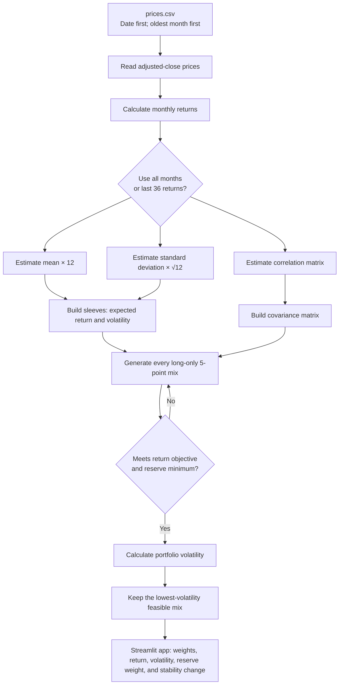

# Lab 15 — Portfolio Stability Decision

- **Date:** 2026-10-22
- **Universe:** BIL, IEF, LQD, and VT
- **Objective:** at least 6.5% annualized historical mean-return estimate
- **Hard constraint:** at least 10% BIL (reserve-eligible) weight
- **Method:** long-only portfolios in 5-percentage-point weight increments;
  select the feasible portfolio with the lowest annualized volatility.

## Data and estimates

`data/processed/prices.csv` contains 61 aligned monthly adjusted-close prices
from 2021-10-01 through 2026-10-01. Its raw Yahoo Finance responses and
retrieval metadata are in `data/raw/`. Downloaded 2026-10-22.

Historical estimates are not forecasts. The app calculates monthly price
returns, arithmetic mean × 12, sample standard deviation × sqrt(12), and the
correlation matrix from the selected sample.

## Results

| Sample | BIL | IEF | LQD | VT | Expected return | Volatility | Reserve-eligible | Largest change from all months |
| --- | ---: | ---: | ---: | ---: | ---: | ---: | ---: | ---: |
| All 60 monthly returns | 55% | 0% | 0% | 45% | 6.81% | 6.74% | 55% | — |
| Last 36 monthly returns | 85% | 0% | 0% | 15% | 6.80% | 1.78% | 85% | 30 points |

Interpretation: the low-risk mix changes materially when the historical sample
changes. This is evidence of estimation risk, not a forecast or a recommended
allocation.

## Engine flowchart



## Run the app

From `Labs/Lab-14-Meridian`:

```powershell
..\..\.tools\python-3.13.15\Scripts\streamlit.exe run app.py
```

Upload `Project-2-Portfolio-Stability/data/processed/prices.csv`, set the
objective to 6.5%, set the reserve minimum to 10%, and tick BIL as
reserve-eligible.

## Still requires student/partner work

- Draw the flowchart yourself on paper and explain the search function to your
  partner before using this reference version.
- Record a real dated partner-attack discussion in `partner-discussions/`.
- State whether you adopt, pilot, or reject the mix and the condition that
  would change that decision.
